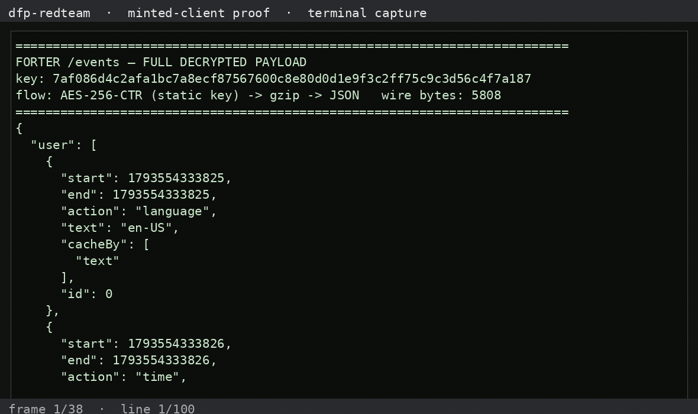

# dfp-redteam-forter — Forter sensor (Wish.com)

Forter's client-side fraud sensor. Full details in the writeups:
`FORTER_SENSOR_PASS_2026_10_31.md` (first pass) and
`FORTER_DECRYPT_2026_11_01.md` (the decrypt).

---

## What we observed (the shipped payload)

**The `/events` telemetry is fully readable: AES-256-CTR with a STATIC key
recovered from the sensor → gzip → plaintext JSON.**

- Wire envelope: a binary blob (the "`Be` magic" from the first pass was just
  the first ciphertext bytes, not a header — out length == in length).
- Decryption: `AES-256-CTR(key=7af086d4c2afa1bc7a8ecf87567600c8e80d0d1e9f3c2ff75c9c3d56c4f7a187,
  counter=aa3ba71ff157dcb6ea1bfe788d1e700b)` → gzip → JSON.
- Plaintext shape (19 signals per event):

```json
{
  "user": [ 19 action records: language, browser, plugins, load, cfp (canvas),
            hdls, ipfi, mcon, opd, rndrtl, scr, wgp (webgl),
            jsm, stm, webgl, wrtc, imm, pow ],
  "bcn": "10913773-011f-43f0-b867-d1857d93e8ce",
  "si": "9b7afadc4f9b",
  "powt": "GEBme0ihiCI=-4096-v2",
  "userId": "b1382e45317640ad8042a326de331dc3",
  "userAgent": "Mozilla/5.0 ...",
  "url": "https://www.wish.com/",
  "refer": ""
}
```

The static key was confirmed at runtime by hooking `crypto.subtle.importKey`
on the real sensor — matches the static init exactly. The `pow` field is a
server-issued PoW cost gate (`num=4096`), not payload integrity.

## The decrypt/tamper harness

`scripts/ftr-decrypt.py` — decrypt a captured `/events` blob, dump the JSON,
modify a signal, re-encrypt, and show the round-trip:

```bash
python3 scripts/ftr-decrypt.py <captured-blob.bin>
```

### Recorded run — plaintext + tamper round-trip (2026-11-01)

```
decrypted JSON keys: ['user', 'bcn', 'si', 'powt', 'userId', 'userAgent', 'url', 'refer']
  bcn: 10913773-011f-43f0-b867-d1857d93e8ce | si: 9b7afadc4f9b | userId: b1382e45317640ad8042a326de331dc3
  actions: ['language', 'time', 'browser', 'plugins', 'load', 'cfp', 'hdls', 'ipfi', 'mcon', 'opd', 'rndrtl', 'scr', 'wgp', 'jsm', 'stm', 'webgl', 'wrtc', 'imm', 'pow']

TAMPERED: webgl.mtHardwareConcurrency 12 -> 2, UA -> Chrome/999

round-trip:
  orig wire len: 5808 | new wire len: 5793
  orig head: a1426501bff79575 | new head: a1426501a364721f
  re-decrypt new wire head: b'{"user":'

  -> structurally identical envelope; server can't tell it from a genuine beacon by format.
```

**Proof:** the captured wire blob decrypts to full readable JSON (canvas/webgl/
UA/network signals), and a tampered copy re-encrypts to a structurally
identical envelope — the transport provides zero integrity because **the key
ships in the client**. Captured blobs + decrypted outputs in
`artifacts/decrypted/`.

## Status

- 🟢 Read payload: full 19-signal plaintext via recovered AES-CTR key
- 🟢 Tamper with payload: decrypt → modify → re-encrypt round-trip proven
- 🟡 Mint token: payload forgeable, but the `pow` token is server-issued (not minted)

## Demo video — the full shipped payload

**Watch the capture** (terminal capture of `scripts/demo-forter.py` printing
the complete decrypted `/events` payload — wire 5,808 B → AES-CTR → gzip →
full JSON, 19 signals, no truncation):



<video controls preload="metadata" width="720"><source src="assets/videos/full-payload-demo.mp4" type="video/mp4"></video>

Reproduce it yourself:

```bash
python3 scripts/demo-forter.py artifacts/decrypted/events-full.json
```

The full plaintext JSON is also at `artifacts/decrypted/events-full.json`
(24,556 B).
[Download the mp4](https://raw.githubusercontent.com/JWally/dfp-redteam-forter/main/assets/videos/full-payload-demo.mp4)

## Files

- `scripts/ftr-decrypt.py` — decrypt + tamper harness
- `scripts/ftr-raw2.mjs` — captures the wire blob as raw bytes (sendBeacon hook)
- `scripts/ftr-subtle.mjs` — hooks `crypto.subtle` to confirm the static key
- `artifacts/decrypted/` — decrypted payloads (full, ice, tampered)
- writeups: `FORTER_SENSOR_PASS_2026_10_31.md`, `FORTER_DECRYPT_2026_11_01.md`
